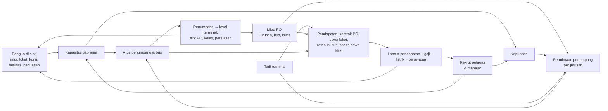

# 13 · Rancangan Tycoon: dari idle ke tycoon

> **Status: dirilis sebagai 0.3.0 (9 Oktober 2026)** di `main` & bustation.games. Langkah 1–6 selesai (bagian 15): modul murni & kalibrasi, `GameState`, save skema 3, UI lima tab, tutorial, target, tantangan, penghargaan, notifikasi, dan analitik memakai ekonomi tycoon, dan adegan 3D mengikuti bangunan & petugas (bagian 12). Belum: bentuk adegan bangunan bertingkat tahap 4–5 (tahap 3 dirilis di 0.4.1, 5 November 2026, sebagai Sayap 2 Lantai, dokumen 16), judul game (masih "Idle Bus"), dan keputusan terbuka bagian 16. Dokumen ini mengubah arah game menjadi **tycoon**: terminal tumbuh lewat bangunan dan petugas yang nyata, bukan level tahap yang naik tanpa batas.
>
> **Pembaruan 0.3.1 (dirilis 9 Oktober 2026):** penumpang tidak lagi membayar terminal (biaya layanan & tarif toilet dihapus), pendapatan utama terminal kini **kontrak PO** yang dibayar di muka (bagian 6.5), dan tempo dikalibrasi ulang (bagian 14). Keputusan 9–16 di bagian 2.
>
> **Pembaruan dokumen 15 (disetujui owner dan dibangun 31 Oktober 2026, dirilis di 0.4.0, 3 November 2026):** izin level, slot PO lebih rapat, hadiah armada & percepat proyek, tantangan laba & target harian yang menghitung kontrak dirata-rata, ambang tantangan kepuasan dari awal minggu, dan patokan tempo baru (keputusan 17–20, bagian 4.1, 6.5, 8, 10, 11, 14, 15). Temuan playtest yang masih terbuka ada di bagian 16.
>
> **Pembaruan dokumen 17 (Musim Terminal; disetujui owner 5 November 2026, ADR 009; sedang dibangun untuk 0.5.0):** musim 6 minggu, tugas harian, Rapor Musim, hiasan terminal, dan Surat Armada (keputusan 21–26, bagian 10, 11, 13, 15, 16). Angka ekonomi dan patokan tempo bagian 14 tidak berubah: Musim tidak memberi uang, XP terminal, boost, atau percepat proyek.
>
> Angka di dokumen ini adalah hasil kalibrasi (bagian 14), masih bisa digeser. Angka yang berlaku selalu yang di `EKONOMI.tycoon` (`src/config/economy.config.ts`).

## 1. Ringkasan

Pemain adalah pengelola terminal. Ia membangun halte, jendela loket, kursi, fasilitas, dan perluasan di **slot** denah yang sudah ada, merekrut petugas, menggandeng mitra PO, mengatur **tarif terminal**, lalu menjaga **laba bersih**: pendapatan dikurangi gaji, listrik, dan perawatan. Tidak ada level tahap, pengali milestone, maupun reset prestige. Terminal tumbuh secara fisik sampai Terpadu. Setelah itu tantangannya adalah mengelolanya dengan baik.



## 2. Keputusan

| # | Keputusan | Akibatnya di rancangan |
|---|---|---|
| 1 | Konsep **tycoon**, bukan idle. Panel Tahap dihapus | Kapasitas berasal dari bangunan & petugas (bagian 4–5) |
| 2 | Ada **biaya operasional**. Yang dikejar **laba bersih** | Gaji, listrik, perawatan dibayar terus. Terminal bisa rugi (bagian 6) |
| 3 | **Offline tetap menghasilkan**, paling lama 8 jam | Butuh Manajer Operasional. Laba offline = (pendapatan + kontrak PO dirata-rata) × 60% − biaya penuh (bagian 9) |
| 4 | **Renovasi (prestige) dihapus** | Terminal tumbuh terus lewat perluasan. Ekspansi ke kota lain bisa jadi fitur nanti |
| 5 | **Skala uang realistis** | Rupiah wajar (ribuan sampai miliar), tanpa pengali ×2 dan angka 1e15 |
| 6 | **Berbasis slot** di denah tetap (usulan, mengikuti diskusi) | Tidak ada penempatan bebas. Jalur orang & bus tetap seperti sekarang |
| 7 | **Kas tidak bisa minus** | Biaya dibayar dari kas. Bila kas habis, petugas berhenti satu per satu. Tanpa utang (bagian 6.3) |
| 8 | **Tarif terminal**: PO mengatur harga tiketnya sendiri, pemain mengatur tarif terminal | Sewa loket, retribusi bus, parkir, sewa kios (bagian 6.4). Pengaturan harga per PO × jurusan dihapus |
| 9 | **Penumpang tidak membayar terminal** (9 Oktober 2026): biaya layanan & tarif toilet dihapus tanpa pengganti di sisi penumpang | Penumpang membayar harga tiket PO saja. Toilet & musholla gratis. Hanya parkir pengantar yang bertarif |
| 10 | **Kontrak PO dibayar di muka** | Saat PO bergabung & tiap perpanjangan, nilainya langsung masuk kas (bagian 6.5) |
| 11 | **Panjang kontrak ditawarkan PO** | 5–30 hari terminal, diundi menurut tingkat PO: PO kecil pendek, PO besar panjang |
| 12 | **Nilai kontrak ikut armada PO** | Tingkat PO, level PO, dan kelas terminal |
| 13 | **Biaya daftar PO dihapus** | Mendaftarkan PO gratis; batasnya slot PO & jendela |
| 14 | **Slot PO terus bertambah** seiring level terminal | Satu slot tiap 10 level setelah Lv 60, sampai 20 di Lv 140. Sejak dokumen 15, slot ke-7/8/9 di Lv 17/19/27 (sebelumnya 20/25/30); ujungnya tetap 20 di Lv 140 (bagian 6.5) |
| 15 | Loket menampilkan **"+N tiket"**, bukan "+Rp" | Uang tiket milik PO. N = tiket yang dibeli pembeli itu (dengan rombongannya) |
| 16 | HUD menampilkan **penumpang di terminal**, bukan arus | Penumpang yang sedang menunggu = arus × lama menunggu |
| 17 | **Izin level** (31 Oktober 2026, dokumen 15): sejak Perluasan 3, slot jendela & jalur juga bertambah dari level | Tidak ada bentang > 45 menit tanpa aksi bernilai sebelum Terpadu. Tempo aktif lebih cepat (bagian 4.1, 8, 14) |
| 18 | **Hadiah non-uang** (dokumen 15): armada PO & percepat proyek, dari target, tantangan, dan iklan opt-in | Hadiah tetap bermakna saat kas menumpuk. Tidak ada hadiah yang hanya lewat iklan (bagian 10) |
| 19 | **Laba tantangan & target harian menghitung kontrak dirata-rata** (dokumen 15) | Kontrak PO sekaligus tidak lagi menyelesaikan tantangan; target harian laba ikut tumbuh (bagian 10) |
| 20 | **Ambang tantangan kepuasan dari awal minggu** (dokumen 15) | Field save opsional `ambang` (skema tetap 3); baris tantangan membuka popup kepuasan (bagian 10, 11) |
| 21 | **Musim Terminal** (5 November 2026, dokumen 17, ADR 009): musim 6 minggu dari kalender di config. Musim 1 "Musim Hujan" mulai Senin 30 November 2026. Terbuka di Lv 6 sesudah tutorial | Tujuan yang terbarui sesudah Terpadu, tanpa mengubah aturan offline: tugas dan Rapor hanya maju saat main aktif. Tidak ada yang direset, jadi tetap sejalan dengan keputusan 4. Hiasan dan lencana tetap dimiliki sesudah musim berganti (bagian 10) |
| 22 | **Tugas harian dan Rapor Musim** (dokumen 17): 3 tugas per hari WIB, berlaku 2 hari, tanpa beruntun, 1 ganti gratis per hari. Tugas +10 poin, tantangan mingguan +40. Rapor 30 tingkat × 45 poin | Target harian, Bus Emas, penghargaan, event, dan iklan tidak memberi poin (bagian 10) |
| 23 | **Hadiah musim: kosmetik dan kemudahan, bukan uang** (dokumen 17) | Lencana, bingkai foto, spanduk gapura, seragam petugas, papan gapura, tiket ganti tugas, dan Surat Armada (+½ level untuk PO pilihan pemain, di tingkat 12 dan 25). Tanpa uang, XP terminal, boost, atau percepat, jadi patokan tempo bagian 14 tidak berubah. Surat Armada menaikkan nilai kontrak secara tidak langsung; owner menerimanya sebagai kemudahan |
| 24 | **Musim tanpa iklan** di ronde 1 (dokumen 17) | Tidak ada tugas yang menuntut iklan. Iklan tidak pernah memberi poin, tingkat, atau hiasan |
| 25 | **Blok save `musim`** opsional, skema tetap 3 (dokumen 17) | `versiMinimal` naik ke 0.5.0 saat rilis Musim, supaya klien 0.4.x tidak menghapus progres musim lewat cloud save (bagian 13) |
| 26 | **Analitik musim** (dokumen 17): 6 peristiwa GA4 baru dan parameter `ringkasan_sesi.musim_tingkat`, tanpa data pribadi | Owner mendaftarkan dimensinya di konsol GA4. Pemrosesan data tidak berubah jenisnya; `privasi.html` diperiksa (bagian 13) |

Keputusan dokumen 12 yang **tetap berlaku**: loket milik terminal disewa PO, level & kelas terminal dari penumpang, kontrak PO, perluasan lima tahap yang permanen dan bertingkat, proyek tetap berjalan saat offline.

## 3. Yang dihapus, diubah, dan dipertahankan

| Sistem | Sekarang (0.2.0, idle) | Tycoon |
|---|---|---|
| Tahap Peron / Loket / Keberangkatan | Level tanpa batas, biaya ×1,08–1,09 per level | **Dihapus.** Kapasitas dari halte, jendela loket, gerbang, petak, dan petugas |
| Milestone | Kapasitas ×2 di Lv 25/50/100/200 | **Dihapus** |
| Kepala (3) | Syarat penghasilan offline | **Dihapus.** Diganti Manajer Operasional & Manajer Kemitraan yang bergaji |
| Renovasi | Reset kapasitas, +10% pendapatan per poin | **Dihapus** |
| Bonus level terminal | +4% pendapatan per level | **Dihapus.** Level membuka slot PO, kelas, dan perluasan saja |
| Bonus kepuasan | +25% pendapatan | **Diubah.** Kepuasan menambah jumlah penumpang, bukan pengali uang |
| Permintaan | Relatif terhadap kapasitas (kapasitas naik → penumpang ikut naik) | **Diubah.** Pasar penumpang mutlak per jurusan. Membangun melebihi pasar hanya menambah biaya |
| Fasilitas | Berlevel, biaya eksponensial | **Diubah.** Unit di slot (kios, toko aula, toilet, lahan parkir, pos retribusi) dengan biaya perawatan |
| Jalur bus | Bonus kapasitas | **Inti kapasitas:** 1 jalur = 1 halte kedatangan + 1 gerbang keberangkatan |
| Modernisasi | Pengali kapasitas, sekali beli | **Tetap**, ditambah biaya perawatan. "Pengatur bus" menjadi peran petugas |
| Mitra PO | Level, loket, jurusan, kelas, reputasi, harga, kontrak | **Tetap**, kecuali harga. PO membayar **kontrak di muka** (bagian 6.5), sewa jendela loket & retribusi bus, dan punya **kepuasan mitra** (bagian 7.1) |
| Harga tiket | Diatur pemain per PO × jurusan (50–200%), tombol Saran | **Diganti tarif terminal** (bagian 6.4). Harga tiket = harga normal PO |
| Level & kelas terminal | XP = penumpang, kurva 4.500 × (L − 1)^3,2 | **Tetap**, kurva disesuaikan dengan arus realistis (bagian 8) |
| Perluasan | Lima tahap, proyek sehari terminal | **Tetap.** Biaya realistis, dan tiap tahap menambah slot |
| Boost iklan ×2, Bus Emas | Pengali & hadiah uang | **Tetap**, hadiahnya dihitung dari laba (bagian 10) |
| Target harian & tantangan | "Upgrade 10×", "upgrade 40×" | **Diubah:** laba, penumpang, kepuasan, bangun |
| Event, papan peringkat, cloud save | | **Tetap** |

## 4. Area & kapasitas

Arus penumpang dibatasi area yang paling sempit, sama seperti sekarang. Bedanya, kapasitas tiap area kini berasal dari benda yang dibangun:

```
arus = min(permintaan, peron, loket, keberangkatan, pangkalan)       (pnp per jam terminal)
peron          = halte kedatangan × 100 × (1 + 0,25 × petugas peron per halte) × modernisasi peron
loket          = Σ PO: min(permintaan PO, jendela PO × 50 × modernisasi loket)
keberangkatan  = gerbang × 150 × (1 + 0,25 × petugas gerbang per gerbang) × modernisasi keberangkatan
pangkalan      = petak bus × 25 pnp ÷ 0,75 jam                        (bus parkir, dicuci, menunggu jadwal)
```

Bila arus jam sibuk melebihi peron, keberangkatan, atau pangkalan, arus semua PO dipotong sebanding. Kursi ruang tunggu tidak membatasi arus; kursi masuk ke kepuasan (bagian 7).

### 4.1 Slot

| Area | Unit | Awal | Slot | Bertambah lewat |
|---|---|---|---|---|
| Jalur | 1 halte kedatangan + 1 gerbang keberangkatan | 1 | 5 | Perluasan 4 (Gedung Antarpulau, +1), 5 (+1), dan izin Lv 16 dan Lv 26 (+1 masing-masing); totalnya 7 dan 9, sama dengan sebelum dokumen 15 (dulu +2 per tahap) |
| Jendela loket | Disewa satu PO | 1 | 4 | Perluasan 1 (+2), 2 (+2), 3 (lantai 2, +4), 4 (aula kedua, +4), 5 (+4), dan izin level (+1 tiap level Lv 11–30, lalu tiap level genap sampai Lv 140) |
| Blok kursi ruang tunggu | 60 kursi | 1 | 4 | Perluasan 3 (lantai 2, +4) |
| Petak parkir bus | Kelompok 5 petak (dibangun lewat perluasan) | 2 | 2 | Perluasan 2 (+2), 3 (+2), 4 (dek, +2), 5 (dek, +4). Petak tahap 0–5: 10 / 10 / 20 / 30 / 40 / 60 (`EKONOMI.tycoon.petakBus`; tahap 3 dulu 20) |
| Kios ruang tunggu | Disewakan | 0 | 3 | |
| Toko aula (minimarket, apotek) | Disewakan | 0 | 2 | Perluasan 3 (food court) |
| Toilet | Blok | 0 | 1 | Perluasan 3 (+1) |
| Lahan parkir kendaraan | Baris | 0 | 1 | Perluasan 2 (baris kedua) |
| Pos retribusi | Pintu masuk bus | 0 | 1 | |
| Modernisasi | Sekali beli | | 6 | Seperti sekarang |

**Izin level (keputusan 17, dokumen 15 bagian 3).** Sejak Perluasan 3 terminal mendapat izin saat naik level. Izin hanya menambah **slot**; unitnya tetap dibeli seperti biasa, atau dibangun PO yang bergabung. Tidak ada proyek dan tidak ada field save: slot diturunkan dari level (XP) dan tahap perluasan (`EKONOMI.tycoon.izinLevel`).

| Izin | Level |
|---|---|
| Slot jendela loket +1 | Tiap level Lv 11–30, lalu tiap level genap Lv 32–140 |
| Slot jalur +1 | Lv 16 dan Lv 26. Slot tahap jalur menjadi `[5, 5, 5, 5, 6, 7]`, jadi totalnya tetap 7 di Perluasan 4 dan 9 di Perluasan 5 |

- Izin yang levelnya sudah lewat sebelum Perluasan 3 selesai aktif sekaligus saat Perluasan 3 diresmikan.
- Izin level sendiri tidak mengubah adegan. Sampai tahap 2 adegan menggambar 8 jendela, 5 halte/gerbang, dan 4 kelompok parkir. Sejak Perluasan 3, Sayap 2 Lantai juga menggambar jendela ke-9 sampai ke-24, blok kursi ke-5 sampai ke-8, serta toko ke-3 dan ke-4 sebagai kios teras food court (dokumen 16 bagian 5). Jendela di atas 24, jalur 6–9, petak 21–60, dan toilet ke-2 tetap tak terlihat.
- Save lama tidak kehilangan unit: slot baru ≥ slot lama di tiap level dan tahap. Perapian bangunan saat memuat memakai level dari XP.

Di terminal awal (1 jalur, 1 jendela, 2 kelompok petak, satu PO berjurusan Jakarta), arusnya min(permintaan ±135, peron 100, loket 50, keberangkatan 150, pangkalan 333) = 50 pnp/jam. Loket menjadi yang paling lambat, sama seperti sekarang, jadi langkah pertama tutorial tetap "bangun loket". Setelah dua jendela, peron (100) yang paling lambat, sehingga petugas peron dan Jalur 2 langsung berguna. Pangkalan baru membatasi sekitar 300 pnp/jam (perluasan 2).

### 4.2 Bangun

| Unit | Biaya | Perawatan per hari |
|---|---|---|
| Jalur 2 / 3 / 4 / 5 | Rp 15 jt / 60 jt / 250 jt / 800 jt | Rp 500 rb per jalur |
| Jalur 6 / 7 / 8 / 9 | Rp 1,5 M / 2,5 M / 4 M / 6 M | Rp 500 rb per jalur |
| Jendela loket | Rp 2 jt, naik 25% per jendela | Rp 150 rb |
| Blok kursi | Rp 4 jt | Rp 50 rb |
| Kios | Rp 5 jt | Rp 100 rb |
| Minimarket, apotek | Rp 12 jt | Rp 250 rb |
| Toilet | Rp 8 jt | Rp 200 rb |
| Lahan parkir kendaraan | Rp 6 jt | Rp 100 rb |
| Pos retribusi | Rp 6 jt | Rp 100 rb |
| Modernisasi | Rp 10 jt (mesin tiket) – Rp 400 jt (gate otomatis) | 0,1% harganya |

- **Bongkar**: unit bisa dibongkar dengan pengembalian 30% biaya. Gunanya untuk mengurangi biaya perawatan bila salah bangun.
- **Jendela loket kosong** (tidak disewa PO) tidak melayani dan tidak membayar sewa, tapi tetap butuh perawatan.

## 5. Petugas

Petugas menggantikan Kepala. Mereka juga mengisi peran yang sudah terlihat di adegan (petugas gerbang, juru parkir, satpam, petugas kebersihan). Gaji dibayar terus selama terminal beroperasi. Terminal buka 24 jam, jadi satu **posisi** berarti tiga shift; gaji di tabel adalah gaji satu posisi per hari.

| Peran | Efek | Batas | Gaji per posisi per hari |
|---|---|---|---|
| Petugas peron | +25% kapasitas halte kedatangannya | 1 per halte | Rp 450 rb |
| Petugas gerbang | +25% kapasitas gerbangnya | 1 per gerbang | Rp 450 rb |
| Petugas kebersihan | Kebersihan: 1 orang per 150 pnp/jam | 2 per jalur + 2 | Rp 360 rb |
| Satpam | Keamanan: 1 orang per jalur | 2 per jalur | Rp 450 rb |
| Juru parkir | Tanpa juru parkir, pendapatan parkir kendaraan −50% | 1 per lahan | Rp 300 rb |
| Petugas toilet | Tanpa petugas, kebersihan toilet ikut turun | 1 per toilet | Rp 300 rb |
| Petugas retribusi | Tanpa petugas, pos retribusi hanya memungut separuh bus | 1 per pos | Rp 360 rb |
| Manajer Operasional | Syarat terminal beroperasi saat game ditutup (bagian 9) | 1 | Rp 1,5 jt |
| Manajer Kemitraan | Memperpanjang kontrak & mengisi jendela kosong otomatis (pengganti Kepala Kemitraan) | 1 | Rp 1,2 jt |

- Petugas **jendela loket** adalah pegawai PO. Terminal tidak membayarnya.
- Rekrut dan berhentikan tanpa biaya sekali bayar, supaya mengatur jumlah petugas mengikuti jam sibuk & musim terasa ringan. Gaji dihitung per detik.
- State menyimpan **urutan rekrut**, bukan jumlah: yang terakhir direkrut berhenti lebih dulu (bagian 6.3), dan bila bangunannya dibongkar, kelebihan petugasnya keluar mulai dari yang terbaru.

## 6. Uang: pendapatan, biaya, laba

### 6.1 Pendapatan

Semua tarif diatur pemain (bagian 6.4). Angka di bawah memakai tarif bawaan.

| Sumber | Rumus | Syarat |
|---|---|---|
| Kontrak PO | Dibayar di muka saat PO bergabung & tiap perpanjangan (bagian 6.5) | PO terdaftar |
| Sewa jendela loket | Rp 250 rb per hari per jendela yang disewa PO | |
| Retribusi bus | Rp 100 rb per bus yang berangkat | Pos retribusi (tanpa petugasnya separuh) |
| Parkir kendaraan | Rp 5 rb × kendaraan pengantar (±30% penumpang) | Lahan parkir (kapasitas per baris) |
| Sewa kios & toko | Rp 300 rb per hari per unit yang terisi | Kios / toko |

- **Harga tiket** ditetapkan PO sendiri: harga normal = Rp 60 rb × nilai jurusan × nilai kelas × 1,06^(level PO − 1). Contoh: Jakarta Ekonomi Rp 60 rb, Surabaya Eksekutif Rp 230 rb, Medan Sleeper Rp 1,5 jt. **Penumpang membayar tiket saja** (keputusan 9); uangnya milik PO. Toilet & musholla gratis.
- Sampai 0.3.0 penumpang juga membayar biaya layanan (10% tiket) dan toilet (Rp 2 rb), ±70–90% pendapatan terminal. Sebagai gantinya ada kontrak PO, dan retribusi dinaikkan dari Rp 20 rb ke Rp 100 rb per bus (±Rp 4 rb per penumpang, dibayar PO) supaya operasi terminal tetap berlaba di awal.
- **Modal awal** Rp 25 jt. Terminal baru tanpa fasilitas sedikit merugi (±Rp 1 jt per hari: perawatan & listrik melebihi sewa satu jendela). PO kedua langsung membayar kontraknya di muka, jadi barang awal (petugas, pos retribusi, lahan parkir, modernisasi pertama) terbeli di menit-menit pertama. Laba hari pertama ±Rp 25 jt (kontrak dirata-rata).
- **Biaya daftar PO** dihapus (keputusan 13): mendaftarkan PO gratis, PO-lah yang membayar.

### 6.2 Biaya

| Pos | Rumus |
|---|---|
| Gaji | Jumlah posisi × gaji per hari (tabel 5) |
| Perawatan | Jumlah unit × perawatan per hari (tabel 4.2) |
| Listrik | Rp 600 rb per hari per jalur. Malam hari ×1,5 (lampu) |
| Gedung perluasan | Biaya operasional tiap tahap yang selesai (bagian 8) |
| Kompensasi | Sisa nilai kontrak yang dikembalikan saat memutus PO (bagian 6.5) |

- Gaji, perawatan, dan listrik dikali kelas terminal: Tipe C 1 · B 1,25 · A 1,5 · Terpadu 2. Kenaikannya dibuat landai supaya naik kelas tidak terasa seperti hukuman.
- Semua dihitung per detik, tapi dilaporkan **per hari** (laporan keuangan, bagian 11).

### 6.3 Kas habis

- Kas tidak pernah minus. Pendapatan & biaya dihitung per detik, dan biaya dibayar dari kas.
- Bila kas Rp 0 dan biaya masih lebih besar dari pendapatan, gaji tidak terbayar. Petugas yang terakhir direkrut berhenti, satu orang per jam terminal, sampai biaya tertutup. Manajer berhenti paling akhir.
- Bila tidak ada petugas lagi dan perawatan masih belum tertutup, perawatan tertunda: kenyamanan & kebersihan turun sampai kas cukup lagi.
- Notifikasi memperingatkan lebih dulu (kas tinggal kurang dari sehari biaya), dengan saran: kurangi petugas, ubah tarif, atau bongkar unit yang tidak terpakai.

### 6.4 Tarif terminal

| Tarif | Bawaan | Rentang | Bila dinaikkan |
|---|---|---|---|
| Sewa jendela loket (per hari) | Rp 250 rb | Rp 0–1 jt | Kepuasan mitra PO turun |
| Retribusi bus (per bus) | Rp 100 rb | Rp 0–300 rb | Kepuasan mitra PO turun |
| Parkir kendaraan | Rp 5 rb | Rp 0–20 rb | Lebih sedikit pengantar yang parkir; komponen harga di kepuasan turun |
| Sewa kios & toko (per hari) | Rp 300 rb | Rp 0–2 jt | Unit bisa kosong bila sewa melebihi nilai keramaiannya |

- Biaya layanan (% harga tiket) & tarif toilet dihapus 9 Oktober 2026 (keputusan 9), begitu pula elastisitas permintaan terhadap harga: harga tiket di tangan PO dan selalu normal.
- Sewa jendela sengaja tetap kecil: bila sewanya jauh di atas perawatan jendela (mis. Rp 1 jt), membangun jendela melebihi permintaan selalu untung.
- Tiap tarif punya tombol **Saran**: tarif yang memaksimalkan laba saat ini, seperti saran harga 0.2.0.
- **Anti-curang** seperti 0.2.0: hadiah "N menit laba", target, rekor, dan offline dihitung dengan tarif bawaan, supaya tarif ekstrem sesaat tidak menggelembungkan hadiah.

### 6.5 Kontrak PO (9 Oktober 2026)

- **Bergabung gratis**; PO membayar kontrak pertamanya di muka. Kontrak pertama PO awal (Ondel-Ondel) sudah termasuk modal awal.
- **Panjang** ditawarkan PO (keputusan 11): 5 / 7 / 10 / 14 / 21 / 30 hari terminal, diundi tetap per PO & kontrak ke-berapa (tawaran tidak berubah saat game dimuat ulang) menurut bobot tingkatnya. Kontrak pertama PO hadiah (kelas & event) 14 hari.

  | Tingkat | 5 | 7 | 10 | 14 | 21 | 30 |
  |---|---|---|---|---|---|---|
  | Lokal | 3 | 4 | 2 | 1 | | |
  | Regional | 1 | 3 | 3 | 2 | 1 | |
  | Nasional | | 1 | 2 | 3 | 2 | 1 |
  | Premium | | | 1 | 2 | 3 | 2 |

- **Nilai** (keputusan 12) = Rp 7,5 jt × tingkat (Lokal 1 · Regional 1,6 · Nasional 2,6 · Premium 4) × 1,08^(level PO − 1) × kelas terminal (C 1 · B 1,5 · A 2,2 · Terpadu 3,2) × hari × potongan kontrak panjang (×1,05 / 1 / 0,96 / 0,92 / 0,87 / 0,82), dibulatkan ke tiga angka penting. Contoh: PO lokal Lv 1 di Tipe C, 7 hari = Rp 52,5 jt; PO nasional Lv 5 di Tipe A, 14 hari ≈ Rp 752 jt.
- **Perpanjangan**: PO menawarkan kontrak baru saat sisa kontraknya ≤ 3 hari; diterima → menyambung sisa yang lama, nilainya dibayar di muka. PO hanya menawarkan bila kepuasan mitranya ≥ 50% (dan syarat kepuasan PO premium terpenuhi). Manajer Kemitraan menerimanya otomatis saat tinggal sehari. PO terakhir selalu menerima tawarannya sendiri, supaya terminal tidak pernah tanpa PO.
- **Habis** tanpa diperpanjang: PO keluar, jendelanya kosong, riwayatnya disimpan.
- **Putus**: sisa nilai kontrak dikembalikan pro-rata sebagai **kompensasi** (kas harus cukup), reputasi −10, jeda 3 hari. PO terakhir tidak bisa diputus.
- **Laporan & hadiah**: buku harian mencatat kontrak pada hari diterima, jadi laba hari itu melonjak. Rata-rata sehari di laporan, hadiah "N menit laba", target tantangan laba, dan laba offline memakai nilai kontrak yang **dirata-rata** sepanjang kontraknya. Peringatan kas menipis memakai laba operasi tanpa kontrak, karena kontrak berikutnya bisa masih berhari-hari lagi.
- **Slot PO** terus bertambah (keputusan 14): 2 → 3 (Lv 3) → 4 (Lv 6) → 5 (Lv 10) → 6 (Lv 14) → 7 (**Lv 17**) → 8 (**Lv 19**) → 9 (**Lv 27**) → 10 (Lv 40) → … → 20 (Lv 140) (`EKONOMI.mitra.terminal.slot`). Lebih dari 8 butuh aula kedua (perluasan 4).
  - Slot ke-7/8/9 dimajukan oleh dokumen 15 bagian 3 (sebelumnya Lv 20/25/30). Bersama izin jendela, slot PO 9–20 kini benar-benar terpakai (pemain kasual 15/15 PO di hari nyata ke-14, sebelumnya 7/14). Di playtest, slot ke-6 sampai ke-9 terisi 0–11 menit main setelah terbuka (sebelumnya slot ke-7 baru terisi 24 menit kemudian dan slot ke-8 tidak pernah).

## 7. Penumpang, permintaan, kepuasan

Model segmen 0.2.0 (PO × jurusan × kelas, persaingan, kejenuhan, reputasi) tetap dipakai. Bedanya, permintaan kini **mutlak**, dan harga tidak lagi memengaruhi permintaan: harga tiket di tangan PO, dan sejak 9 Oktober 2026 penumpang tidak membayar terminal:

```
pasar_j        = 45 pnp/jam × peminat_j × pengali kelas terminal × daya tarik kepuasan × ritme jam
pengali kelas  = Tipe C 1 · B 1,3 · A 1,6 · Terpadu 2
daya tarik     = 0,6 + 0,8 × kepuasan
permintaan_ij  = pasar_j × bagian PO i (reputasi, persaingan, kejenuhan)
```

Akibatnya:

- Membangun loket untuk PO yang permintaannya kecil tidak menambah penumpang.
- Menambah jurusan lewat PO baru, naik kelas, dan menjaga kepuasan adalah cara memperbesar pasar.

**Kepuasan** (0–100%) menggerakkan daya tarik (permintaan) dan reputasi PO:

| Komponen | Bobot | Dari |
|---|---|---|
| Kelancaran | 30% | Antrean: permintaan dibanding kapasitas tiap area |
| Kenyamanan | 20% | Kursi dibanding penumpang yang menunggu, modernisasi (AC, papan jadwal) |
| Kebersihan | 20% | Petugas kebersihan & petugas toilet dibanding arus |
| Keamanan | 10% | Satpam per jalur, terutama malam hari |
| Fasilitas | 10% | Toilet, kios, toko aula, lahan parkir |
| Harga | 10% | Tarif parkir dibanding tarif bawaan |

### 7.1 Kepuasan mitra PO

Tiap PO punya kepuasan mitra (0–100%) terhadap terminal:

| Dari | Naik bila |
|---|---|
| Sewa jendela loket & retribusi bus | Tarifnya di bawah bawaan |
| Penumpang PO itu | Bus-busnya penuh |
| Jendela loket | Antrean di jendela PO itu pendek (jendela cukup) |
| Kepuasan terminal | Penumpang puas |

- PO hanya menawarkan perpanjangan kontrak bila kepuasan mitra ≥ 50%, juga untuk Manajer Kemitraan (bagian 6.5).
- PO baru hanya mau bergabung bila perkiraan kepuasan mitranya ≥ 50%.
- Reputasi PO tidak lagi turun karena harga (harga tiket di tangan PO), tapi masih mengikuti kepuasan penumpang & armada.

## 8. Progres

- **Level terminal** tetap dari penumpang yang diberangkatkan. Arus kini realistis (puluhan sampai ribuan pnp per jam terminal, bukan ratusan per detik), jadi kurvanya berubah: XP kumulatif level L = **50 × (L − 1)^2,75** penumpang. Tempo mendekati keputusan 6 dokumen 12 (Tipe B ±1,4 jam, Tipe A ±5,9 jam, Terpadu ±17 jam):

  | Level | 3 | 6 | 10 (Tipe B) | 20 (Tipe A) | 30 (Terpadu) |
  |---|---|---|---|---|---|
  | Penumpang kumulatif | 340 | 4,2 rb | 21 rb | 164 rb | 525 rb |
  | Waktu main aktif (pemain serakah) | ±3 menit | ±32 menit | ±1,6 jam | ±6,3 jam | ±13,1 jam |

  Sejak dokumen 15 kurvanya **tidak** diubah, tapi waktunya maju karena dinding Lv 11–20 hilang: Tipe A ±5,1 jam, Terpadu ±10,9 jam (bagian 14). Kurva XP sengaja tidak diperlambat: level diturunkan dari XP yang tersimpan, jadi kurva baru akan menurunkan level dan kelas save yang sudah ada.

- **Kelas terminal**, slot PO, dan kelas bus mengikuti level seperti 0.2.0; slot PO kini terus bertambah (bagian 6.5).
- **Izin level** (bagian 4.1): sejak Perluasan 3, tiap level di Tipe B dan Tipe A menambah satu slot jendela loket; slot jalur ke-6 dan ke-8 datang di Lv 16 dan Lv 26.
  - **Yang dicapai:** dinding mid-game hilang. Bentang buntu terpanjang pemain serakah sebelum Terpadu turun 257 → 41 menit, dan slot PO ke-6 sampai ke-9 langsung terisi (bagian 6.5).
  - **Yang belum** (playtest 31 Oktober 2026, pengikut baris tujuan di 3×): tidak tiap level punya sesuatu untuk dikerjakan. Hanya 9–10 dari 20 level di Lv 11–30 membawa pembelian atau PO baru. Pemain membeli 2–3 jendela sejak Lv 11, sementara baris tujuan menampilkan "slot jendela loket +1" 38–42% waktu di Lv 10–29. Jeda terpanjang antar-pembelian tetap 70–76 menit main (menabung untuk Jalur 5 di Lv 14–17 dan Jalur 7 di Lv 21–27), seperti sebelum izin (70 menit). Lihat bagian 16.
- **Perluasan** tetap lima tahap pada Lv 3 / 6 / 10 / 20 / 30, dengan biaya Rp 20 jt / 80 jt / 250 jt / 800 jt / 3 M. Proyeknya tetap sehari terminal. Tiap tahap menambah slot (tabel 4.1), bukan pengali. Setelah selesai, gedungnya punya biaya operasional per hari: Rp 0,5 jt / 2 jt / 6 jt / 20 jt / 60 jt (menumpuk).
- **Laba** pemain serakah dengan tarif bawaan (dari tes tempo, bagian 14; kontrak PO dirata-rata sepanjang kontraknya):

  | Saat | Laba per hari terminal (24 menit nyata) | Biaya ÷ pendapatan |
  |---|---|---|
  | Hari pertama | ±Rp 25 jt | ±15% |
  | Tipe B (hari ke-10) | ±Rp 140 jt | ±16% |
  | Tipe A (hari ke-22) | ±Rp 205 jt | ±22% |
  | Terpadu (hari ke-40–43) | ±Rp 450–470 jt | ±23% |

  Kontrak PO ±50% pendapatan di awal dan ±75–80% di akhir permainan; sisanya operasi (retribusi, parkir, sewa).

  Sejak dokumen 15 (diukur di kode): laba hari ke-10 ±Rp 197 jt dan hari ke-40 ±Rp 663 jt (sebelumnya ±Rp 139 jt dan ±Rp 452 jt), biaya ÷ pendapatan ±18%, tidak ada hari rugi.

## 9. Offline

- Terminal hanya beroperasi saat game ditutup bila ada **Manajer Operasional**. Tanpa manajer, terminal tutup: tidak ada pendapatan dan tidak ada biaya.
- Dengan manajer, laba offline = (pendapatan + nilai kontrak PO yang dirata-rata) × 60% − biaya penuh, paling lama **8 jam**, cukup untuk semalam tidur. Kontrak ikut dihitung karena ia pendapatan utama terminal: tanpanya laba offline akhir permainan minus. Sisa kontrak tidak berkurang selama pergi (jam terminal berhenti). Bisa negatif bila petugasnya terlalu banyak. Popup "Selama kamu pergi…" menampilkan pendapatan, biaya, dan laba.
- Jam terminal berhenti selama game ditutup, jadi pendapatan offline dihitung dari rata-rata hari biasa dengan tarif pemain, tapi tidak pernah melebihi hasil tarif bawaan: tarif ekstrem sesaat sebelum keluar tidak menggelembungkan laba offline.
- Kas tetap tidak minus: bila habis, petugas berhenti satu per satu seperti bagian 6.3 dan biayanya ikut turun. Bila Manajer Operasional ikut berhenti, terminal tutup untuk sisa waktunya. Popup menyebut petugas yang berhenti.
- Proyek perluasan tetap berjalan, dengan atau tanpa manajer (keputusan 8 dokumen 12).

## 10. Target, tantangan, penghargaan, event, iklan

- **Target harian**: penumpang (tetap) dan **laba bersih hari ini ≥ X**. "Upgrade 10×" dihapus.
  - **Laba (keputusan 19, dokumen 15 bagian 5.1):** X = setengah laba rata-rata sehari **dengan** kontrak PO yang dirata-rata (tarif bawaan), paling sedikit 12 × Rp 200 rb. Kemajuan bertambah tiap tick main aktif sebesar (laba operasi + kontrak per jam) × jam terminal; uang kontrak yang masuk sekaligus tidak ikut. Sampai 0.3.1, X dihitung dari laba operasi dan kontrak hari itu ikut menambah kemajuan, sehingga X selalu jatuh ke batas bawah Rp 2,4 jt dan hanya tercapai di hari ada kontrak.
- **Tantangan mingguan**: tiga dari empat jenis diundi tiap minggu: penumpang, laba bersih, kepuasan selama 60 menit main, dan bangun 15 unit atau modernisasi. "Upgrade 40×" dihapus.
  - **Laba (keputusan 19):** targetnya tetap laba rata-rata dengan kontrak × 180 jam terminal. Kemajuannya sama dengan target harian: kontrak dihitung dirata-rata per jam main, bukan sekaligus; kompensasi putus tidak lagi menguranginya. Sampai 0.3.1 tantangan laba minggu pertama selesai di menit main ke-1–2 karena kontrak PO kedua.
  - **Kepuasan (keputusan 20):** ambangnya = kepuasan saat minggu dimulai, dibulatkan ke bawah ke kelipatan 5%, dijepit 50–75% (mis. 28% → 50%, 56% → 55%, 91% → 75%); lamanya tetap 60 menit main. Ambang disimpan di field opsional `ambang` tantangan itu (skema tetap 3); save lama tanpa field ini menghitungnya dari kepuasan saat dimuat. Sampai 0.3.1 ambangnya tetap 75%, yang hampir mustahil setelah Terpadu karena permintaan tumbuh melebihi kapasitas peron.
- **Hadiah non-uang (keputusan 18, dokumen 15 bagian 4):** paket hadiah = uang + **armada** (XP untuk PO berlevel terendah, sebagian dari kebutuhan level berikutnya PO itu; seri: penumpangnya terbanyak) + **percepat proyek** (−6 menit main pada proyek perluasan yang berjalan). PO sasaran armada ditulis sebelum klaim, dan aturan "PO berlevel terendah" tertulis di catatan tantangan dan tab PO.

  | Sumber | Uang | Armada | Percepat |
  |---|---|---|---|
  | Target harian | 2 menit laba | ½ level | 6 menit, bila ada proyek berjalan |
  | Tantangan mingguan (tiap tantangan) | 15 menit laba | 1 level | – |
  | Bus Emas (iklan) | 10 menit laba | ¼ level | – |
  | Tombol "Percepat 6 menit" di kartu perluasan (iklan) | – | – | 6 menit, hanya bila sisa proyek > 12 menit (paling banyak 2× per proyek) |

  Klaim 2× (iklan) menggandakan seluruh paket; tombolnya di target harian berlabel "2× semua". Proyek bisa selesai seketika lewat 2 iklan percepat ditambah klaim target 2×; ini diterima, karena batas atasnya (Tipe A 4,7 jam, Terpadu 10,5 jam) tetap dalam patokan (dokumen 15 bagian 4.3). Penghargaan dan event tetap uang saja. XP terminal sengaja tidak dipakai sebagai hadiah: 5 menit arus per hari terminal memajukan Terpadu ±1,6 jam.
- **Penghargaan**: yang berbasis level tahap (mis. `level100`) diganti. Kini 20 penghargaan (`PENCAPAIAN_IDS`), antara lain petugas pertama, Manajer Operasional, lima jalur, tujuh hari tanpa rugi, kas Rp 1 M, aula loket penuh, dan Terpadu.
- **Hadiah "N menit pendapatan"** menjadi "N menit laba": laba rata-rata per jam hari biasa dengan tarif bawaan, termasuk kontrak PO yang dirata-rata, paling sedikit Rp 200 rb per menit supaya tetap terasa saat rugi.
- **Boost iklan** tetap: pendapatan ×2 selama 30 menit (kontrak PO tidak ikut). Bus Emas tetap; sejak dokumen 15 ia juga memberi armada (tabel di atas). Semua iklan tetap pilihan, dan tiap jenis hadiah iklan juga bisa didapat tanpa iklan.
- **Event musiman** tetap: pasar penumpang naik (Mudik ×1,5, Nataru ×1,3, HUT RI ×1,17), jadi kapasitas & petugas tambahan terasa gunanya.
- **Musim Terminal** (keputusan 21–24, dokumen 17 bagian 3–5). Jangan dikacaukan dengan event musiman: event mengubah pasar, Musim tidak menyentuh angka ekonomi.
  - **Tugas harian:** 3 per hari WIB, satu dari tiap kelompok (*main*, *sorotan*, *kelola*). Targetnya dibuat dari laju terminal saat itu, ±8–10 menit main; tugas *kelola* adalah satu keputusan yang aman bagi kas (cadangan B). Tugas maju hanya saat main aktif, tidak saat offline, dan berlaku 2 hari. Begitu selesai, +10 poin langsung masuk, tanpa tombol klaim dan tanpa 2× iklan.
  - **Target harian** tidak berubah dan tidak memberi poin. Ia dihitung per hari terminal, jadi poin darinya akan menghadiahi lama main, bukan kehadiran.
  - **Tantangan mingguan** tidak berubah, kecuali +40 poin musim per tantangan yang diklaim atau dikirim otomatis. Urutan di `perbaruiJamNyata` menjadi event → tantangan → musim, jadi tantangan minggu terakhir masuk ke musim yang lama. P-9 ("Bangun 15 unit") tidak diubah oleh Musim (bagian 16).
  - **Paket hadiah armada** tetap ke PO berlevel terendah. **Surat Armada** (Rapor tingkat 12 dan 25) memakai rumus XP yang sama, ½ × kebutuhan level berikutnya, tetapi PO-nya dipilih pemain.
  - **Tidak memberi poin:** target harian, Bus Emas, boost, klaim 2×, penghargaan, event, dan iklan. Papan peringkat tidak menerima poin musim.
  - **Event dan Musim bersamaan:** spanduk event menang atas spanduk musim, dan target tugas memakai laju yang sudah termasuk pengali event.

## 11. UI

- **Tab**: Bangun · Petugas · PO · Terminal · Target. Tab Tahap, Fasilitas, dan Modern digabung ke Bangun.
- **Bangun**: dikelompokkan per area (Peron & jalur, Loket, Ruang tunggu, Pangkalan, Fasilitas, Modernisasi). Tiap kartu menampilkan unit, jumlah/slot, efeknya pada area, biaya, perawatan, dan alasan bila belum bisa (mis. "slot penuh: Perluasan 2"). Sejak dokumen 15, bila izin level datang lebih dulu dari perluasan: "Slot penuh: +1 di Lv L".
- **Petugas**: jumlah per peran dengan tombol − / +, efeknya, gaji, dan total gaji per hari.
- **PO**: pengaturan harga per jurusan dihapus. Kartu PO menampilkan harga tiket PO (informasi), kepuasan mitra, kontrak, dan jendela loketnya. Tombol perpanjang berisi tawaran PO ("Perpanjang N hari" & nilainya) dan baru muncul saat sisa kontrak ≤ 3 hari; keterangan putus menyebut kompensasinya. PO tersedia urut katalog, tiap baris berisi tawaran kontraknya.
  - Bila slot jendela penuh, status PO tersedia menunjuk dari mana slot jendela berikutnya datang: "Jendela penuh · +1 di Lv L" (izin level), "Jendela penuh · Perluasan N", atau "Jendela penuh" bila tidak ada lagi (dokumen 15 bagian 3.5). Sebelumnya "Slot jendela loket penuh: bangun perluasan terminal", yang salah arah sejak Perluasan 3.
  - Teks penjelasan tab PO menyebut bahwa hadiah armada (target, tantangan, Bus Emas) menaikkan level PO berlevel terendah.
- **Terminal**: level & kelas, perluasan, **tarif** (dengan tombol Saran), dan **laporan keuangan** (hari ini & kemarin: pendapatan per sumber, biaya per pos, laba, kas).
  - Kartu level mendapat baris "Izin berikutnya: Lv L {izin} · Lv L2 {izin2}" (dokumen 15 bagian 3.5). Selama proyek berjalan, kartu perluasan menampilkan tombol iklan "▶ Percepat 6 menit" dengan catatan "iklan · maks. 2× per proyek" (dokumen 15 bagian 4.4).
- **Target** (dokumen 15 bagian 4.4 dan 5.3):
  - Baris tantangan kepuasan berbunyi "Jaga kepuasan ≥ A% selama 60 menit main", dengan "kini K% ›" di kanan yang membuka popup kepuasan. Selama tantangan itu aktif, popup kepuasan menampilkan baris "🎯 Tantangan: ≥ A% · x/60 menit main".
  - Catatan kartu tantangan: "Tantangan baru tiap Senin (WIB). Laba dihitung seperti Laba/hari: kontrak PO dirata-rata. 🚌 Armada selalu untuk PO berlevel terendah."
  - Kartu target harian menampilkan paket hadiahnya, dengan armada dalam level: "Hadiah: +Rp X · 🚌 PO … +½ level · 🏗️ −6 mnt". Tombol 2× target berlabel "▶ 2× semua" bila paketnya berisi armada atau percepat; tombol 2× penghargaan tetap "▶ 2×".
  - Kartu tantangan menulis hadiahnya sekali: "Hadiah tiap tantangan: +Rp X · 🚌 PO … +1 level".
  - Toast setelah klaim menyebut kemajuan armada PO itu ("🚌 Armada baru PO …: 0% → 50% menuju Lv 4"). Bila armada menaikkan level PO, yang tampil teks naik level PO ("⬆️ PO … naik ke Lv 6: kelas Eksekutif & jurusan YOGYAKARTA").
  - **Kartu Musim** (dokumen 17 bagian 7–8), di atas kartu lain tab Target. Kartu ini baru ada sesudah tutorial selesai dan Lv 6. Isinya:
    - kepala (tema, tingkat, sisa hari), bilah poin, dan hadiah berikutnya;
    - 3 baris tugas, ditambah set kemarin bila masih berlaku, masing-masing dengan "›" ke tuasnya, dan tombol Ganti;
    - bagian **Hiasan terminal** (pakai/lepas) dan Surat Armada.
- **Popup Musim** (dokumen 17 bagian 3.5, 8):
  - sambutan, sekali saat Musim terbuka;
  - **Rapor Musim** di akhir musim, tampil sesudah popup offline bila ada, jadi paling banyak dua popup berturut-turut;
  - pilih PO untuk Surat Armada.
- **Toast Musim:** tugas selesai ("📋 Tugas selesai · +10 poin Rapor") dan naik tingkat Rapor, beserta hiasan yang terpasang.
- **Lencana tab Target** mendapat titik bila ada hadiah Rapor baru yang belum dilihat. Jumlah tugas tersisa tidak ditampilkan sebagai lencana, supaya tidak menagih.
- **Popup Bus Emas** menyebut uang dan armadanya: "… Tonton iklan untuk Rp X dan armada baru PO … (+¼ level)."
- **Toast & baris tujuan** (dokumen 15 bagian 3.5):
  - toast naik level menyebut izin yang terbuka ("🏢 Terminal naik ke Lv 16: slot jendela loket +1 & slot jalur +1"); bila level itu juga membuka slot PO, yang tampil toast slot PO;
  - toast slot PO saat slot jendela penuh menunjuk sasaran yang sama dengan status tab PO ("🅿️ Slot PO ke-7 terbuka: jendela loket penuh sampai Lv 18", atau sebelum Perluasan 3 "🅿️ Slot PO ke-5 terbuka: jendela loket penuh sampai Perluasan 3");
  - tingkat 5 baris tujuan menampilkan izin terdekat ("⬆️ Lv 17: slot jendela loket +1 & slot PO ke-7 · kini Lv 16"). Sejak dokumen 17, bila Musim terbuka dan ada tugas yang belum selesai, tingkat 5 lebih dulu menampilkan tugas itu ("📋 Tugas: … · 210/400"), tanpa aksi, sebelum "naik level";
  - popup offline menyebut izin yang terbuka selama pergi.
- **HUD**: kas, laba, penumpang di terminal (keputusan 16), kepuasan, jam.
  - **Laba rata-rata per hari** ("Laba ±Rp X/hari", termasuk kontrak PO yang dirata-rata), bukan lagi "Hari ini ±Rp X · N pnp". Netral selama tutorial dan jam terminal pertama, lalu hijau/merah; diketuk membuka laporan keuangan. Disetujui owner 29 Oktober 2026 dan dibangun 31 Oktober 2026 (dokumen 14 bagian 4.1): laba hari ini hampir selalu merah di hari tanpa kontrak, walau terminal sehat.
  - Baris di bawahnya adalah **tujuan berikutnya** (dokumen 14 bagian 3), menggantikan baris petunjuk. Saran Manajer Operasional pindah ke sana (muncul saat gajinya aman dan, sejak 31 Oktober 2026, saat laba offline-nya sehari tidak minus), dan penutup tutorial tidak lagi menyarankannya. Sejak dokumen 15 (perbaikan U-2), kunci tujuan berbiaya memuat unitnya (mis. nomor jalur), supaya pembelian berikutnya dinilai lagi dengan cadangan kas.
  - Pil kepuasan memakai aturan netral yang sama dengan pil laba: tidak merah atau hijau selama tutorial dan jam terminal pertama (dokumen 14 bagian 4.1, disetujui owner 31 Oktober 2026).
- **Adegan**: label area (PERON, LOKET, KEBERANGKATAN, PANGKALAN) bisa diketuk untuk membuka kartu Bangun area itu. Area yang membatasi arus ditandai sorotan lantai merah berdenyut; label teks "PALING LAMBAT" dihapus atas permintaan user (9 Oktober 2026).
- **Mode ringkas** hanya menyembunyikan panel. Rel chip tahap dihapus.
- **Layar penuh** (9 Oktober 2026, permintaan user): panel bisa menutupi adegan karena tab yang berisi banyak pengaturan terlalu sempit di bawah adegan. Adegan berhenti digambar selama itu dan kameranya tidak berubah.
- Semua di atas sudah diterapkan (langkah 3); label area yang bisa diketuk menyusul di langkah 4 (bagian 12). Label PANGKALAN hanya muncul saat pangkalan yang paling lambat, karena di sana sudah ada papan "PANGKALAN BUS".

## 12. Adegan 3D

Sebagian besar sudah menggambarkan benda nyata: halte & gerbang per jalur, jendela loket per PO, kelompok parkir per tahap, kios & toko berpintu gulung, modernisasi, dan petugas statis. Yang perlu ditambah atau diubah:

- **Blok kursi** ruang tunggu muncul sesuai yang dibangun. Sekarang keempatnya selalu ada.
- **Petugas** terlihat sesuai yang direkrut: petugas peron per halte, petugas gerbang, kebersihan (siang juga, tidak hanya malam), satpam, juru parkir, petugas toilet, dan petugas retribusi.
- **Lahan parkir kendaraan** (baris 1, baris 2 di tahap 2) dan **pos retribusi** mengikuti yang dibangun.
- **Label area** bisa diketuk (bagian 11).

Yang sudah ikut langkah 2: lencana "K" dihapus dari label area, sorotan area yang membatasi arus jam sibuk mengikuti `bottleneckState`, penjaga kios & toko hadir per unit yang dibangun, dan juru parkir, petugas toilet, serta petugas retribusi hanya hadir bila bangunannya ada **dan** petugasnya direkrut. Efek "+Rp" memetakan enam sumber pendapatan ke empat tempat transaksi (loket, bus parkir, lorong parkir, kios/toko); "+Rp" sewa kios harian dihapus. Sejak 9 Oktober 2026 loket menampilkan "+N tiket" (keputusan 15), dan "+Rp" tinggal tiga sumber: retribusi (bus parkir), parkir (lorong parkir), dan sewa kios & toko (kios/toko).

Langkah 4 (9 Oktober 2026; logika murni di `src/game/fasilitas-adegan.ts`, posisi di `tata-letak.ts`):

- **Blok kursi** terpasang sebanyak unit kursi, mulai dari blok terdekat gerbang Jalur 1. Blok 1–4 ada di ruang tunggu. Sejak Perluasan 3, blok ke-5 sampai ke-8 ada di lantai 2 Sayap 2 Lantai (dokumen 16) dan diisi orang statis, bukan penumpang yang memilih kursi. Penumpang memilih kursi di blok terpasang dulu; bila penuh, ia **berdiri** menunggu di lantai blok yang belum dipasang, jadi kursi yang kurang terlihat (dan loket tidak tertahan).
- **Petugas** sebanyak yang direkrut: petugas peron di tepi peron tiap halte, petugas gerbang di tiap gerbang (urut jalur), satpam di empat pos (luar yang berpatroli malam, aula, peron keberangkatan, peron kedatangan), dan petugas kebersihan siang & malam di empat rute sapu (aula, ruang tunggu, peron, plaza). Sisanya bertugas di luar pandangan.
- **Parkir**: baris mobil pertama (beserta deret motor) terisi setelah lahan parkir pertama, baris kedua setelah lahan parkir kedua; tanpa lahan parkir tidak ada calon penumpang dari parkir. **Pos retribusi** muncul setelah dibangun.
- **Kios & toko per unit**: kios ruang tunggu urut KOPI, ROTI & KUE, OLEH-OLEH; toko aula urut minimarket lalu apotek. Yang belum dibangun tertutup rolling door dan tidak didatangi. Toilet & musholla baru didatangi setelah toilet dibangun.
- **Label area** berpanah "›" bisa diketuk: membuka tab Bangun di bagian area itu (Peron & Keberangkatan → jalur, Loket → jendela, Pangkalan → petak bus) dan menyorot barisnya. Zona Pangkalan ikut disorot saat paling lambat.

## 13. Save & rilis

- Skema save **3**. Belum ada pemain, jadi save 0.1/0.2 tidak dimigrasi (`migrasiKeV3`): ekonomi dimulai baru, dan hanya profil (nama terminal & persetujuan papan peringkat) serta benih cuaca yang dibawa. Statistik ikut mulai dari nol, karena uang idle tidak sebanding dengan Rupiah tycoon dan jam terminal kembali ke Senin 06.00.
- `versiMinimal` dinaikkan ke versi rilis tycoon (mis. 0.3.0).
- Papan peringkat: batas kenaikan skor di server kini 100 penumpang per detik main (`ARUS_WAJAR_MAKS`, terminal terbesar ±26). Server ikut `npm run deploy:web`, dan klien lama dipaksa memperbarui lewat `versiMinimal`.
- **`versiMinimal` sesudahnya** (`src/config/rilis.config.ts`):

  | Rilis | `versiMinimal` | Alasan |
  |---|---|---|
  | 0.3.1 | 0.3.1 | Kontrak PO dibayar di muka (bagian 15 langkah 7) |
  | 0.4.0 | 0.4.0 | Izin level: versi lama memotong jendela dan jalur save baru ke tabel tahap perluasan tanpa pengembalian uang, dan kerugiannya tersimpan permanen |
  | 0.4.1 | tetap 0.4.0 | Sayap 2 Lantai hanya gambar adegan; tanda peresmian ada di localStorage terpisah |
  | 0.5.0 (Musim) | **0.5.0** | Blok save `musim` (keputusan 25, di bawah) |

- **Musim Terminal** (keputusan 25–26, dokumen 17 bagian 9):
  - **Save:** blok opsional baru `musim` di `GameState` dan `SaveV3`, dan skema tetap 3. Save tanpa blok ini mendapat nilai bawaan "belum terbuka". Bila Lv ≥ 6 dan tutorial sudah selesai, Musim terbuka saat save dimuat, dengan popup sambutan sekali. Nilai yang tidak sah disaring saat dibaca. Ukuran blok sesudah setahun ±1.900 karakter.
  - **Klien lama** (0.4.x) mengabaikan blok `musim` dan menghapusnya saat menyimpan. Karena itu `versiMinimal` naik ke 0.5.0 saat rilis.
  - **Rollback ke 0.4.x** menghapus progres musim pada simpan berikutnya, sedangkan ekonomi aman. Ini dicatat di rencana rollback rilis 0.5.0.
  - **Cloud save** membawa blok `musim` utuh, dan konflik tetap ditanyakan ke pemain. Poin musim tidak dikirim ke papan peringkat.
  - **Analitik:** 6 peristiwa baru (`musim_buka`, `tugas_selesai`, `tugas_ganti`, `rapor_naik`, `rapor_musim`, `hiasan_pakai`) dan parameter `ringkasan_sesi.musim_tingkat`, lewat `PencatatAnalitik`, tanpa data pribadi. Owner mendaftarkan dimensinya di konsol GA4 (daftarnya di dokumen 17 bagian 9.2). Musim berjalan penuh tanpa jaringan, dan tidak ada server baru.

## 14. Kalibrasi & target tempo

Tempo untuk pemain aktif yang bermain optimal, diukur dengan pemain serakah (`tests/tycoon-sim.ts`, dijaga `tests/tycoon-tempo.test.ts`). Tiap jam terminal ia membeli aksi yang paling cepat balik modal (laba rata-rata jam sibuk & sepi). Perluasan dinilai dari aksi terbaik yang dibuka slot barunya.

Hasil kalibrasi ulang 9 Oktober 2026 (kontrak PO); dalam kurung hasil 0.3.0:

| Momen | Target | Hasil kalibrasi |
|---|---|---|
| PO kedua | < 3 menit | menit ke-0 (0) |
| Perluasan 1 dimulai | < 45 menit | menit ke-3 (35) |
| Jalur 2 | < 30 menit | menit ke-27 (2) |
| Lv 6 | 15–45 menit | menit ke-32 (25) |
| Tipe B (Lv 10) | 75–130 menit | 1,6 jam (1,6) |
| Tipe A (Lv 20) | 5–8,5 jam | 6,3 jam (6,7) |
| Terpadu (Lv 30) | 12–17,5 jam | 13,1 jam (14,8) |
| Perluasan 5 selesai | sebelum 17,5 jam | 13,6 jam (16) |
| Jeda terlama tanpa membeli di jam pertama | ≤ 25 menit | 24 menit (±25) |
| Petugas berhenti karena kas habis | 0 | 0 |

Catatan kalibrasi:

- Percobaan pertama memperlihatkan **pangkalan** (10 petak, bus parkir 1,5 jam = 167 pnp/jam) menjadi tembok sebelum Jalur 2 berguna. Lama parkir bus diturunkan ke 0,75 jam.
- **Jendela loket** mentok 8 sampai perluasan 4 membuat Lv 10–20 sangat lambat. Perluasan 3 kini menambah 4 jendela (lantai 2).
- Di awal, **pasar** (bukan kapasitas) yang membatasi: dua jurusan ±150 pnp/jam. Barang awal dibuat lebih murah dan pasar Tipe C lebih besar, supaya keputusan bermakna muncul tiap 3–10 menit.
- **Biaya** awalnya hanya 5% pendapatan. Gaji kini per posisi tiga shift, perawatan & listrik dinaikkan. Pengali biaya per kelas sempat ×8 di Tipe A sehingga laba anjlok saat naik kelas; kini landai (1 → 2).
- **Akhir permainan** sempat mentok karena peron maksimal di 5 jalur. Perluasan 4 & 5 kini menambah jalur.
- Permintaan di akhir permainan masih ±1,6× kapasitas (kelancaran rendah). Jalur 8–9 adalah jalan keluarnya; pemain serakah memakai tarif bawaan.

Kalibrasi ulang 9 Oktober 2026 (penumpang tidak membayar, kontrak PO):

- Tanpa biaya layanan & toilet terminal kehilangan ±70–90% pendapatannya: terminal baru merugi dan kemajuan hampir berhenti. Kontrak PO menggantikannya.
- Pemain serakah menilai aksi dengan laba rata-rata **termasuk kontrak yang dirata-rata**, ditambah nilai jangka panjang penumpang (2,5 × nilai kontrak per penumpang), karena penumpang menaikkan level PO & terminal yang menaikkan kontrak berikutnya. Tanpa itu ia menimbun kas dan kurang membangun kapasitas. Aksi gratis yang sama cepat balik modalnya (mis. PO baru) dipilih yang tambahan nilainya terbesar.
- Kontrak besar di menit 0 membuat semua barang awal terbeli sekaligus. Bila nilai dasar terlalu besar (Rp 9 jt) pemain serakah juga membeli e-Tiket Rp 80 jt lalu tidak bisa membeli apa pun ±45 menit. Rp 6,5–8,5 jt aman, dipakai Rp 7,5 jt.
- Retribusi dinaikkan ke Rp 100 rb per bus supaya operasi tanpa kontrak tetap berlaba di awal (±Rp 12 jt per hari) dan laba offline bermakna. Sewa jendela tetap Rp 250 rb (bagian 6.4).
- Laba harian di tes tempo memakai kontrak yang dirata-rata (seperti laporan rata-rata & hadiah), karena kontrak yang dibayar di muka membuat laba kas per hari naik-turun tajam.
- Strategi wajar menyisakan kas untuk kerugian operasi sampai tawaran perpanjangan berikutnya. Tanpa itu, setelah membeli Jalur 6 di akhir permainan, kas habis sebelum kontrak berikutnya dan petugas berhenti.
- Jalur 2 kini menit ke-27 (patokan lama 8–12 menit): PO terbaik yang didaftarkan di menit 0 menyewa tiga jendela, sehingga loket, bukan jalur, yang membatasi sampai perluasan 1 selesai. Jeda terpanjang di jam pertama (±24 menit) adalah lama proyek perluasan. Pemain yang mengikuti tutorial tetap membangun Jalur 2 di menit-menit pertama.

### Kalibrasi ulang 31 Oktober 2026: izin level (dokumen 15, disetujui owner)

Dasar: gerbang tahap 0 ADR 004, "tidak ada bentang buntu > 45 menit main aktif sebelum Terpadu". Buntu = tidak ada aksi yang menambah laba atau penumpang, dan perluasan belum terbuka. Bukti dan varian yang ditolak ada di `docs/design/20261031-fondasi-saran-3-6.md` (repo tim). **Patokan baru di bawah berlaku di `tests/tycoon-tempo.test.ts` sejak dokumen 15 dibangun** (31 Oktober 2026), termasuk tes baru "bentang buntu terpanjang sebelum Terpadu ≤ 45 menit". Tabel 9 Oktober di atas tinggal sebagai riwayat. Kolom "dokumen 15" diukur di kode dengan `jalankanSerakah` (QA dan playtest sesudah dibangun), hasilnya sama dengan simulasi rancangan.

| Momen | Patokan lama | 0.3.1 | Dokumen 15 (kode) | Patokan baru |
|---|---|---|---|---|
| PO kedua / Perluasan 1 dimulai / Jalur 2 | < 3 / < 45 / < 30 menit | 0 / 3 / 27 menit | 0 / 3 / 27 menit | tetap |
| Jeda terlama tanpa membeli di jam pertama | ≤ 25 menit | 24 menit | 24 menit | tetap |
| Lv 6 / Tipe B (Lv 10) | 15–45 / 75–130 menit | 32 / 97 menit | 32 / 97 menit | tetap |
| Tipe A (Lv 20) | 5–8,5 jam | 6,3 jam | 5,08 jam | **4,5–8,5 jam** |
| Terpadu (Lv 30) | 12–17,5 jam | 13,1 jam | 10,9 jam | **10–17,5 jam** |
| Perluasan 5 selesai | sebelum 17,5 jam | 13,6 jam | 11,4 jam | tetap |
| Bentang buntu terpanjang sebelum Terpadu | – | 257 menit (Lv 11) | 41 menit (Lv 7) | **≤ 45 menit** (baru) |
| Laba hari 10 > 2× hari 1; hari 40 > 2× hari 10; biaya ÷ pendapatan 10–40%; tiap hari laba > 0 | tetap | lulus (20,2%) | lulus (18,3%) | tetap |
| Petugas berhenti karena kas habis | 0 | 0 | 0 | tetap |

Catatan kalibrasi:

- **Jendela saja tidak cukup.** Membuka slot jendela dari level hanya memindahkan dinding: pertama ke pangkalan (petak 20 di tahap 3), lalu ke pasar (tidak ada slot PO di Lv 14–20), lalu ke peron (jalur 7 sampai Perluasan 5). Yang lolos adalah paket izin jendela + jalur Lv 16/26 + petak tahap 3 = 30 + slot PO 7/8/9 di Lv 17/19/27.
- **Tempo lebih cepat** karena dinding 4 jam itu sendiri dulu yang memperlambat game. Kurva XP tidak diubah: level diturunkan dari XP tersimpan, jadi memperlambatnya akan menurunkan level dan kelas save yang ada.
- Fase 6,5–13,5 jam kini berisi ±200 menit "menabung" untuk jalur Rp 1,5–4 M dan Perluasan 5, bukan buntu: uang kembali punya arti. PO terdaftar sampai jam ke-24: 7 → 10.
- Kepuasan median pemain serakah di 10–13,5 jam turun 79% → 66%: PO yang lebih banyak menambah permintaan di atas kapasitas peron.
- Dengan hadiah yang diklaim (target harian dan sepertiga Bus Emas), Terpadu ±10,5 jam dan satu bentang 48–49 menit. Patokan tes tetap memakai pemain serakah tanpa hadiah. Batas atas dengan proyek yang selesai seketika lewat iklan: Tipe A 4,7 jam, Terpadu 10,5 jam (dokumen 15 bagian 4.3).
- Gerbang 45 menit tipis (41 menit tanpa hadiah). Tiap penyetelan tempo berikutnya perlu melaporkan tiga angka berdampingan (bagian 16).

**Patokan pemain kasual (`tests/tycoon-kasual.test.ts`, dokumen 15).** Pemain serakah bermain dalam sesi pendek. Di antara sesi berlaku rumus offline bagian 9 (dengan Manajer, direkrut menurut aturan baris tujuan dokumen 14). Panjangnya 14 hari nyata. Batas sebelum izin level ada di dokumen 15 bagian 2.3.

| Ukuran | K3 (3 sesi/hari: 15 + 10 + 20 mnt) | K2 (2 sesi/hari: 10 + 10 mnt) | Batas tes |
|---|---|---|---|
| Terpadu | hari nyata ke-2 | hari nyata ke-3 | K3 hari 2–4, K2 hari 3–5 |
| XP terminal dari offline | 94% | 96% | K3 85–98% |
| Sesi berisi keputusan hari 4–7 (0.3.1 → dokumen 15) | 0% → 25% | 25% → 75% | K3 ≥ 20%, K2 ≥ 50% |
| Hari terakhir dengan keputusan (0.3.1 → dokumen 15) | 3 → 12 | 4 → 12 | K3 ≥ 10 |
| Petugas berhenti | 0 | 0 | 0 |

Tes unit modul murni: `tests/bangunan.test.ts`, `petugas.test.ts`, `tarif.test.ts`, `operasi.test.ts` (termasuk pasar mutlak: membangun melebihi permintaan tidak menambah arus), `keuangan.test.ts` (termasuk overbuild merugi dan kas tidak pernah minus). Tes offline (Manajer Operasional, batas 8 jam, jam mundur, tarif ekstrem tidak menggelembungkan laba offline, kas habis) ada di `tests/state.test.ts` sejak langkah 2.

## 15. Rencana implementasi bertahap

0. ✓ **Rancangan ini** + keputusan (bagian 2 & 16).
1. ✓ **Modul murni & kalibrasi** (`src/sim/bangunan.ts`, `petugas.ts`, `tarif.ts`, `operasi.ts`, `keuangan.ts`, blok `EKONOMI.tycoon`):
   - kapasitas area, pasar mutlak per jurusan, pendapatan & biaya, kas tidak minus;
   - harga tiket = harga normal PO, tarif terminal, kepuasan mitra PO;
   - kalibrasi lewat pemain serakah & tes tempo.
2. ✓ **Peralihan state & save**:
   - `GameState` memakai bangunan, petugas (urut rekrut), tarif, kas (Rupiah `number`), dan buku harian (pendapatan & biaya per hari);
   - aksi bangun / bongkar / rekrut / berhentikan / atur tarif; offline dengan Manajer Operasional;
   - hapus tahap, Kepala, Renovasi, milestone, bonus level, harga per PO;
   - save skema 3 & cloud save (ekonomi lama dimulai baru, profil tetap).
3. ✓ **UI**: tab Bangun / Petugas, tarif & laporan keuangan di tab Terminal, kartu PO tanpa harga per jurusan, HUD laba, popup offline baru; tab Tahap & rel chip dihapus. Dikerjakan bersama langkah 2 supaya game tetap bisa dikompilasi.
4. ✓ **Adegan 3D**: blok kursi (penumpang berdiri bila kursi kurang), petugas peron, gerbang, kebersihan, & satpam sesuai rekrutan, lahan parkir & pos retribusi, kios & toko per unit, label area yang bisa diketuk, zona Pangkalan (bagian 12). Bangunan bertingkat tahap 3–5 (lantai 2, gedung parkir, Terpadu) masih di luar langkah ini.
5. ✓ **Tutorial**, target harian, tantangan, penghargaan, notifikasi, analitik. Tutorial (sesuai usulan):
   - bangun jendela loket;
   - daftarkan PO kedua;
   - rekrut petugas peron;
   - bangun Jalur 2.
6. ✓ **README & dokumen**, lalu **rilis 0.3.0** (9 Oktober 2026):
   - `version` 0.3.0 di `package.json`, `catatan` baru dan `versiMinimal` 0.3.0 di `src/config/rilis.config.ts`;
   - `tycoon` digabung ke `main` lalu `npm run deploy:web`; `npm run cap:sync` sebelum build APK berikutnya;
   - judul "Bustation: Idle Bus" sengaja belum diubah (nama, `index.html`, manifest PWA, og-image): menunggu keputusan.

7. ✓ **Pembaruan ekonomi**, dirilis **0.3.1** (9 Oktober 2026; `versiMinimal` 0.3.1): biaya layanan & toilet dihapus, kontrak PO dibayar di muka (bagian 6.5), slot PO terus bertambah, "+N tiket" di loket, penumpang di terminal di HUD, panel layar penuh, dan kalibrasi ulang (bagian 14). Save skema 3 tetap; PO dari save 0.3.0 dianggap berkontrak 7 hari yang sudah dibayar.

8. ✓ **Fondasi tahap 0** (dokumen 15; disetujui owner dan dibangun 31 Oktober 2026, dirilis di 0.4.0 pada 3 November 2026 bersama dokumen 14; brief `docs/tasks/20261031-fondasi-saran-3-6.md` di repo tim). Dibangun dalam tiga ronde:
   - **ronde 1**: tes tempo kasual (`tests/tycoon-kasual.test.ts`, `jalankanKasual`); laba tantangan & target harian dengan kontrak dirata-rata; ambang tantangan kepuasan (field save opsional `ambang`, skema tetap 3) dan tautan ke popup kepuasan; perbaikan kunci histeresis baris tujuan (U-2);
   - **ronde 2**: izin level, slot PO lebih rapat, petak tahap 3; paket hadiah (armada PO, percepat proyek; Bus Emas dan tombol iklan "Percepat 6 menit"); patokan tempo baru (bagian 14);
   - **ronde perbaikan teks** (dari playtest): label "2× semua", armada ditulis dalam level, aturan "PO berlevel terendah" tertulis, dan status/toast jendela penuh yang menunjuk izin level (bagian 11).

   Tanpa model 3D baru dan tanpa peristiwa analitik baru (`iklan_hadiah.tempat` mendapat nilai `percepatProyek`). Ingatkan `npm run cap:sync` sebelum APK berikutnya. Temuan yang tersisa ada di bagian 16.

9. ✓ **Sayap 2 Lantai** (dokumen 16 ronde 1): gedung Perluasan 3 dan peresmian susulan, dirilis di 0.4.1 (5 November 2026; `versiMinimal` tetap 0.4.0).

10. **Musim Terminal ronde 1** (dokumen 17) dan **bentuk terminal ronde 2** (dokumen 16 bagian 6: 12 hiasan per level, cadangan lahan seberang), disetujui owner 5 November 2026 (ADR 009, ADR 008). Sedang dibangun untuk 0.5.0 (`versiMinimal` 0.5.0). Rilisnya harus siap sebelum Musim 1 mulai, Senin 30 November 2026. Patokan tempo bagian 14 tidak berubah.

## 16. Keputusan terbuka

Sudah diputuskan (8 Oktober 2026): kas tidak bisa minus, tarif terminal, offline 8 jam (bagian 2).

1. **Harga tiket PO**: selalu harga normal, atau PO ikut menyesuaikan harga sendiri (mis. diskon saat sepi, naik saat musim mudik).
2. **Kota lain** (beberapa terminal): fitur jangka panjang, bukan bagian rilis tycoon pertama.

### Temuan terbuka dari playtest dokumen 15 (31 Oktober 2026)

Untuk tugas berikutnya. Belum diputuskan, dan tidak ada angka yang diubah karenanya. Bukti lengkap ada di `docs/design/20261031-fondasi-saran-3-6-playtest.md` (P-5 sampai P-9) dan QA `docs/reviews/20261031-fondasi-saran-3-6-gameplay-r2.md` (S-4), keduanya di repo tim.

- **P-5 · Izin jendela tiap level menutupi tujuan yang bermakna.**
  - Baris tujuan tingkat 5 menampilkan "slot jendela loket +1" 38–42% waktu di Lv 10–29, padahal pengikut tujuan hanya membeli 2–3 jendela sejak Lv 11 (bagian 8).
  - Tujuan nyata pemain di fase itu adalah menabung untuk Jalur 5–7 atau Perluasan 5, dan baris tujuan tidak punya "menabung" untuk jalur.
  - Arah, tanpa angka ekonomi: tingkat 5 menampilkan izin terdekat yang berisi slot jalur atau slot PO, dan izin jendela saja hanya bila loket paling lambat atau slot jendela penuh; tujuan "menabung" untuk pembelian area paling lambat (mis. "🚦 Peron: kumpulkan Rp 1,2 M lagi untuk Jalur 7"); kartu level "Izin berikutnya: jendela +1 tiap level · Lv 26 slot jalur +1 · Lv 27 slot PO ke-9". Sasaran uji: porsi izin-jendela-saja < 10%.
- **S-4 (QA) · Dataran Lv 21–27.**
  - Pengikut tujuan hanya punya tiga momen keputusan dalam 3,5 jam main: Jalur 6, satu gelombang rekrut/kursi untuk kepuasan, lalu Jalur 7 dan PO ke-9. Pemain serakah: "menabung atau buntu" 88 menit mulai Lv 22.
  - Pembelian berikutnya Rp 2,5–3 M dengan laba ±Rp 0,4–0,5 M per hari terminal, dan tidak ada pembelian kelas menengah yang menambah laba.
  - Arah: jangka pendek P-5 (tabungan terlihat sebagai sasaran); jangka menengah saran 7, sink bertingkat Rp 100–500 jt (tahap 2 ADR 004). Memajukan slot PO ke-9 tidak disarankan, karena hanya memindahkan bentang dan mempercepat Terpadu lagi.
- **P-6 · Gerbang 45 menit tipis.**
  - Pemain serakah tanpa hadiah 41 menit; bila armada harian dan sepertiga Bus Emas diklaim, 49 menit (Lv 17); jeda antar-pembelian pengikut tujuan 69–76 menit main (menabung, bukan buntu menurut patokan).
  - Arah: jangan ubah angka sekarang. Tiap brief tempo berikutnya melaporkan tiga angka berdampingan: serakah (gerbang), serakah + hadiah, dan jeda pengikut tujuan + level yang berisi pembelian. Ukur ulang Lv 17 bila Musim Terminal menambah hadiah.
  - Musim ronde 1 (dokumen 17 bagian 13.3) tidak memberi uang, XP terminal, atau percepat. Surat Armada pertama (Rapor tingkat 12) paling cepat datang di hari musim ke-10, dan di semua run simulasi sesudah Terpadu. Jadi Lv 17 tidak perlu diukur ulang untuk ronde ini. Tes tempo dan kasual tidak memakai Musim.
- **P-7 · Popup offline kurang menghitung izin** (rendah).
  - Lompatan Lv 15 → 23 membuka slot PO ke-7 dan ke-8, tapi tertulis "slot PO ke-8".
  - Bila Perluasan 3 selesai selama pergi, izin level sebelum Perluasan 3 yang aktif sekaligus tidak dihitung.
  - Arah: "slot PO +2 (s.d. ke-8)"; jendela dan jalur dihitung sebagai slot sesudah − slot sebelum.
- **P-8 · Armada meratakan level PO, tidak mengangkatnya.**
  - Level PO di akhir: 6–8, atau 9–10 bila semua iklan ditonton. Sleeper (PO Lv 10) dan Double Decker (Lv 15) belum muncul sampai Lv 32, kecuali Sleeper pada pemain yang menonton semua iklan.
  - Arah: memilih PO sasaran armada sendiri (tahap 1, sudah direncanakan) membuat armada menjadi keputusan.
  - Musim ronde 1 menjawab sebagian: Surat Armada (Rapor tingkat 12 dan 25) memberi +½ level ke PO yang dipilih pemain (dokumen 17 bagian 4.1). Paket hadiah armada dari target, tantangan, dan Bus Emas tetap ke PO berlevel terendah.
- **P-9 · Tantangan "Bangun 15 unit" di minggu ke-2 tidak tercapai** (rendah, sudah ada sebelum dokumen 15).
  - 8/8 run berakhir 0–2/15: sesudah Terpadu yang tersisa hanya jendela izin seharga Rp 0,5–10 M per unit tanpa manfaat.
  - Arah, untuk Musim Terminal: target bangun mengikuti slot yang berguna, atau diganti daftarkan/perpanjang PO atau modernisasi sesudah Terpadu. Perlu simulasi tersendiri.
  - Dokumen 17 (bagian 3.3) tidak mengubahnya. Dengan Musim, minggu yang mengundi tantangan ini juga berarti −40 poin Rapor. Keputusannya terpisah (ADR 009), sebaiknya sesudah ada data GA4 `klaim_tantangan`.
